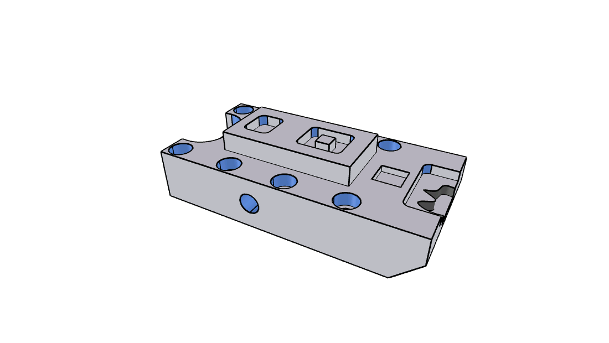

<!-- Generated from schema/mesh.primitive.TM_brep_faces.schema.json by scripts/gen_schema.py. Do not edit. -->
# TM_brep_faces

This extension is for CAD exporters. For each triangle in a glTF mesh it has the index for which exact surface of the original CAD model it came from.

CAD programs don't store a part as triangles. They store it as exact surfaces: planes, cylinders, cones, spheres and tori. These are called analytic surfaces, because a few numbers describe each one completely. For example, a cylinder is just an axis and a radius. Each surface is trimmed to a patch called a face, and faces are joined along their edges. This is called boundary representation, or BREP. When every edge is shared by exactly two faces, the faces close up and surround a solid. A watertight mesh works the same way: every edge is shared by exactly two triangles, once in each direction.

To export a mesh, the CAD program tessellates each face, which means it covers the face with small flat triangles that approximate it. The exact surface is lost in that step. Working with the BREP directly would keep it, but that is hard, because you need a CAD kernel: the large geometry library inside a CAD program. A mesh, on the other hand, can be used by almost anything.

This extension keeps both. Each triangle stores the index of the face it came from, and each face stores its analytic surface. Most code can use the mesh as normal, and code that needs the exact surface can look it up by index, with no kernel. The exporter already has each face in hand while it tessellates it, so this information is nearly free to write. A face whose surface is not one of the analytic types (a free-form surface, for example) is stored as null. The extension is implemented for the OpenCASCADE kernel, but other kernels such as ACIS or Parasolid could export the same information.

All positions and lengths are in meters and all directions are unit vectors, in the same coordinate frame as the primitive's POSITION accessor (before any node transform). All angles are in radians and turn counter-clockwise when seen from the tip of the axis they turn about (the right-hand rule).



The picture is a mesh, not CAD geometry. Faces are tinted by their `type`. The outlines are the edges between triangles with different `faceIndices`, colored by the two kinds of surface they join: green where two planes meet, blue for a plane and a cylinder, red for two cylinders, orange for a plane and a free-form surface. It takes about thirty lines of Python: [examples/show_brep.py](../../examples/show_brep.py).

## Example

```json
{
  "faceIndices": 3,
  "faces": [
    {"type": "cylinder", "face_index": 0, "origin": [0, 0, 0], "axis": [0, 0, 1], "x_dir": [1, 0, 0], "radius": 0.005, "extent_angle": [0, 6.2832], "extent_height": [0, 0.01]},
    null
  ],
  "substance": {"name": "Steel", "density": 7850}
}
```

## Properties

All of these are required, and no other properties are allowed, here or inside a face or a substance.

| Field | Type | Meaning |
|---|---|---|
| `faceIndices` | integer | Index of an accessor with one value per triangle: the position in `faces` of the BREP face that triangle came from. The accessor is SCALAR with an unsigned integer component type, and its count equals the number of triangles in the primitive. |
| `faces` | array | One entry per BREP face, in face index order. An entry is null when the face is not one of the analytic surface types, so positions still match face indices. |
| `substance` | null or Substance | What the part this primitive belongs to is made of, or null if the source file does not say. Every instance of the part shares it. |

## Faces

One BREP face whose surface is a plane, cylinder, cone, sphere or torus. The surface is infinite or closed; the `extent_` fields say which part of it the face covers. A face can be smaller than its extents if its outline is not rectangular in those two directions.

The value types used below:

- point: A position [x, y, z] in meters, in the frame of the primitive's vertices
- direction: A direction [x, y, z] of length 1, in the frame of the primitive's vertices
- range: [min, max]: the stretch of a surface the face covers along one of the surface's two directions, in meters or radians as the field says

Every face has:

| Field | Type | Meaning |
|---|---|---|
| `type` | string | The kind of surface. It decides which other fields are present. |
| `face_index` | integer | Position of this face in the `faces` array, which is the value `faceIndices` holds for its triangles |

and, depending on `type`:

### plane

| Field | Type | Meaning |
|---|---|---|
| `origin` | point | A point on the plane, from which the extents are measured |
| `normal` | direction | Unit direction perpendicular to the plane |
| `x_dir` | direction | Unit direction in the plane: the plane's own X axis. Its Y axis is normal cross x_dir. |
| `extent_x` | range | How far the face reaches along x_dir from origin, in meters |
| `extent_y` | range | How far the face reaches along the plane's Y axis from origin, in meters |

### cylinder

| Field | Type | Meaning |
|---|---|---|
| `origin` | point | A point on the axis, from which heights are measured |
| `axis` | direction | Unit direction of the axis |
| `radius` | number | Distance from the axis to the surface, in meters |
| `extent_angle` | range | The angles the face covers around the axis, measured from x_dir, in radians. A full cylinder covers 2 pi. |
| `extent_height` | range | How far the face reaches along the axis from origin, in meters |
| `x_dir` | direction | Unit direction perpendicular to the axis from which angles are measured. |

### cone

| Field | Type | Meaning |
|---|---|---|
| `apex` | point | The point where the cone comes to a tip. The face itself usually does not reach it. |
| `axis` | direction | Unit direction of the axis |
| `semi_angle` | number | Angle between the axis and the cone's side, in radians. Positive if the cone widens along the axis direction and negative if it narrows. |
| `ref_radius` | number | Radius of the cone's reference circle, in meters. Its center is on the axis at apex + axis * ref_radius / tan(semi_angle). |
| `extent_angle` | range | The angles the face covers around the axis, measured from x_dir, in radians |
| `extent_distance` | range | How far the face reaches along the cone's slanted side, measured from the reference circle in the direction of the axis, in meters |
| `x_dir` | direction | Unit direction perpendicular to the axis from which angles are measured. |

### sphere

| Field | Type | Meaning |
|---|---|---|
| `center` | point | The center of the sphere |
| `radius` | number | Distance from the center to the surface, in meters |
| `extent_longitude` | range | The angles the face covers around the axis, measured from x_dir, in radians |
| `extent_latitude` | range | The angles the face covers above the equator, toward the axis, in radians: from -pi/2 at the south pole to pi/2 at the north pole |
| `axis` | direction | Unit direction from the center to the sphere's north pole. |
| `x_dir` | direction | Unit direction perpendicular to the axis from which longitude is measured. |

### torus

| Field | Type | Meaning |
|---|---|---|
| `center` | point | The center of the torus, on its axis |
| `axis` | direction | Unit direction of the axis the tube circles around |
| `major_radius` | number | Distance from the axis to the middle of the tube, in meters |
| `minor_radius` | number | Radius of the tube, in meters |
| `extent_major_angle` | range | The angles the face covers around the axis, measured from x_dir, in radians |
| `extent_minor_angle` | range | The angles the face covers around the tube, in radians: 0 is the outer edge of the torus and the angle grows toward the axis direction |
| `x_dir` | direction | Unit direction perpendicular to the axis from which angles are measured. |


## Substance

What a part is made of, as the CAD file names it, such as steel or ABS. Not how it looks: that is the primitive's glTF `material`. Only `name` is required.

| Field | Type | Meaning |
|---|---|---|
| `name` | string | The name the source file gives it |
| `density` | number | Mass per volume in kilograms per cubic meter, if the source file gives one: 7850 for steel |

## Schema

[`schema/mesh.primitive.TM_brep_faces.schema.json`](schema/mesh.primitive.TM_brep_faces.schema.json) is the single source of truth. This page, the code in cascadio that writes the extension, and its Python dataclasses are all generated from it.
